# Modelo de datos

Fuente de verdad: [`apps/api/prisma/schema.prisma`](../apps/api/prisma/schema.prisma). Las secciones del diagrama, las entidades y las enumeraciones se regeneran con:

```bash
pnpm db:erd
```

## Convenciones

- Modelos y campos en español; tablas y columnas en `snake_case` (`Tarea.duracionDias` → `tareas.duracion_dias`).
- Montos en CLP con `Decimal(14,2)`; porcentajes con `Decimal(5,2)` entre 0 y 100.
- Fechas de planificación como `date` (sin hora); marcas de auditoría como `timestamp`.
- Duraciones en **días hábiles** según el calendario del proyecto.

## Correspondencia con la EDT

| Nivel en el sistema | Equivale en la EDT (PMBOK)                      | Se programa en el Gantt                     |
| ------------------- | ----------------------------------------------- | ------------------------------------------- |
| `ETAPA`             | Fase o entregable principal                     | Fila resumen (se consolida)                 |
| `ACTIVIDAD`         | Paquete de trabajo, cuando tiene subactividades | Fila resumen, o actividad si no tiene hijas |
| `SUBACTIVIDAD`      | Actividad del cronograma                        | Barra con duración, dependencias y recursos |

## Reglas de integridad

### En la base de datos (restricciones `CHECK`, `UNIQUE` y claves foráneas)

| Tabla                | Regla                                                                                                                                                                                                                    |
| -------------------- | ------------------------------------------------------------------------------------------------------------------------------------------------------------------------------------------------------------------------ |
| `proyectos`          | `presupuesto >= 0`; `fecha_fin >= fecha_inicio` si existe                                                                                                                                                                |
| `calendarios`        | 1 por proyecto; `0 < horas_por_dia <= 24`; `dias_laborables` no vacío y con valores 0–6                                                                                                                                  |
| `feriados`           | Una fecha por calendario                                                                                                                                                                                                 |
| `tareas`             | `codigo` único por proyecto; `duracion_dias >= 0`; avance entre 0 y 100; fin ≥ inicio (plan y real); costos ≥ 0; **una ETAPA no tiene padre y toda ACTIVIDAD/SUBACTIVIDAD sí lo tiene**; una tarea no es su propio padre |
| `dependencias`       | Un solo vínculo por par de tareas; una tarea no depende de sí misma                                                                                                                                                      |
| `profesionales`      | Nombre único; `tarifa_hora >= 0`; `0 < horas_diarias <= 24`                                                                                                                                                              |
| `recursos`           | Nombre único; `costo_unitario >= 0`                                                                                                                                                                                      |
| `asignaciones`       | Exactamente uno de `profesional_id` o `recurso_id`; dedicación entre 0 (excl.) y 100; horas y cantidades ≥ 0; un profesional o recurso no se repite en la misma tarea                                                    |
| `registros_avance`   | Porcentaje entre 0 y 100                                                                                                                                                                                                 |
| `lineas_base`        | `version >= 1` y única por proyecto; costo ≥ 0                                                                                                                                                                           |
| `solicitudes_cambio` | `codigo` único por proyecto; probabilidad e impacto entre 1 y 5; `etapa_actual` entre 1 y 10                                                                                                                             |
| `etapas_cambio`      | `numero` entre 1 y 10 y único por solicitud; adopción entre 0 y 100; fin ≥ inicio                                                                                                                                        |
| `evidencias`         | Tamaño entre 1 byte y 10 MB                                                                                                                                                                                              |
| `kpi_definiciones`   | `codigo` único; un umbral por semáforo                                                                                                                                                                                   |

### Reglas de borrado

- **Cascada:** al borrar un proyecto se borra todo lo que cuelga de él; al borrar una tarea se borran sus hijas, dependencias, asignaciones y registros de avance; al borrar una solicitud, sus etapas, evidencias, acciones e impactos.
- **Restricción:** no se puede borrar un profesional, recurso o tipo de recurso que tenga asignaciones o recursos asociados (se desactiva en su lugar).
- **Anular referencia (`SET NULL`):** hitos, impactos y líneas base conservan su registro si se borra la tarea o solicitud asociada; las líneas base guardan copia del código, nombre, fechas y costo de cada tarea.

### En la aplicación (validadas por la API)

- El padre de una `ACTIVIDAD` es una `ETAPA` y el de una `SUBACTIVIDAD` es una `ACTIVIDAD` (#6).
- Las dependencias solo unen tareas hoja del mismo proyecto y no forman ciclos (#8, #9).
- Las transiciones de estado del proyecto y de las solicitudes siguen sus flujos definidos (#5, #15).

<!-- inicio-generado -->

## Diagrama entidad-relación (23 entidades)

```mermaid
erDiagram
  Proyecto ||--o| Calendario : "proyectoId"
  Calendario ||--o{ Feriado : "calendarioId"
  Proyecto ||--o{ Tarea : "proyectoId"
  Tarea |o--o{ Tarea : "padreId"
  Proyecto ||--o{ Dependencia : "proyectoId"
  Tarea ||--o{ Dependencia : "predecesoraId"
  Tarea ||--o{ Dependencia : "sucesoraId"
  TipoRecurso ||--o{ Recurso : "tipoRecursoId"
  Tarea ||--o{ Asignacion : "tareaId"
  Profesional |o--o{ Asignacion : "profesionalId"
  Recurso |o--o{ Asignacion : "recursoId"
  Tarea ||--o{ RegistroAvance : "tareaId"
  Proyecto ||--o{ Hito : "proyectoId"
  Tarea |o--o{ Hito : "tareaId"
  Proyecto ||--o{ LineaBase : "proyectoId"
  SolicitudCambio |o--o{ LineaBase : "solicitudCambioId"
  LineaBase ||--o{ LineaBaseTarea : "lineaBaseId"
  Tarea |o--o{ LineaBaseTarea : "tareaId"
  KpiDefinicion ||--o{ KpiUmbral : "kpiId"
  KpiDefinicion ||--o{ KpiMedicion : "kpiId"
  Proyecto ||--o{ KpiMedicion : "proyectoId"
  Hito |o--o{ KpiMedicion : "hitoId"
  Proyecto ||--o{ Alerta : "proyectoId"
  Proyecto ||--o{ SolicitudCambio : "proyectoId"
  SolicitudCambio ||--o{ EtapaCambio : "solicitudId"
  EtapaCambio ||--o{ AccionCorrectiva : "etapaId"
  EtapaCambio ||--o{ Evidencia : "etapaId"
  SolicitudCambio ||--o{ ImpactoCambio : "solicitudId"
  Tarea |o--o{ ImpactoCambio : "tareaId"
  Proyecto |o--o{ Bitacora : "proyectoId"
  SolicitudCambio |o--o{ Bitacora : "solicitudCambioId"
  Proyecto {
    Int id PK
    String nombre
    String descripcion
    String responsable
    Decimal presupuesto
    DateTime fechaInicio
    DateTime fechaFin
    EstadoProyecto estado
    DateTime creadoEn
    DateTime actualizadoEn
  }
  Calendario {
    Int id PK
    Int proyectoId FK, UK
    Int_lista diasLaborables
    Decimal horasPorDia
  }
  Feriado {
    Int id PK
    Int calendarioId FK
    DateTime fecha
    String descripcion
  }
  Tarea {
    Int id PK
    Int proyectoId FK
    Int padreId FK
    NivelTarea nivel
    String codigo
    Int orden
    String nombre
    String descripcion
    String responsable
    Int duracionDias
    DateTime inicioPlan
    DateTime finPlan
    DateTime inicioReal
    DateTime finReal
    DateTime fechaFija
    Decimal porcentajeAvance
    DateTime inicioTardio
    DateTime finTardio
    Int holguraDias
    Boolean esCritica
    Decimal costoPlan
    Decimal costoReal
    DateTime creadoEn
    DateTime actualizadoEn
  }
  Dependencia {
    Int id PK
    Int proyectoId FK
    Int predecesoraId FK
    Int sucesoraId FK
    TipoDependencia tipo
    Int desfaseDias
  }
  Profesional {
    Int id PK
    String nombre UK
    String claveNombre UK
    String cargo
    Decimal tarifaHora
    Decimal horasDiarias
    Boolean activo
  }
  TipoRecurso {
    Int id PK
    String nombre UK
    String descripcion
  }
  Recurso {
    Int id PK
    String nombre UK
    String claveNombre UK
    Int tipoRecursoId FK
    String unidad
    Decimal costoUnitario
    Boolean activo
  }
  Asignacion {
    Int id PK
    Int tareaId FK
    Int profesionalId FK
    Int recursoId FK
    Decimal dedicacion
    Decimal horasPlan
    Boolean horasPlanManual
    Decimal horasReales
    Decimal cantidadPlan
    Decimal cantidadReal
  }
  RegistroAvance {
    Int id PK
    Int tareaId FK
    DateTime fecha
    Decimal porcentaje
    String comentario
    RolUsuario rol
    DateTime creadoEn
  }
  Hito {
    Int id PK
    Int proyectoId FK
    Int tareaId FK
    String nombre
    String criterio
    String responsable
    DateTime fechaObjetivo
    DateTime fechaCumplimiento
  }
  LineaBase {
    Int id PK
    Int proyectoId FK
    Int version
    String descripcion
    Int solicitudCambioId FK
    DateTime fechaFinProyecto
    Decimal costoPlanTotal
    DateTime creadoEn
  }
  LineaBaseTarea {
    Int id PK
    Int lineaBaseId FK
    Int tareaId FK
    String codigo
    String nombre
    NivelTarea nivel
    Int duracionDias
    DateTime inicioPlan
    DateTime finPlan
    Decimal costoPlan
  }
  KpiDefinicion {
    Int id PK
    String codigo UK
    String nombre
    String descripcion
    AmbitoKpi ambito
    String formula
    UnidadKpi unidad
    Decimal meta
    DireccionKpi direccion
    Boolean esAdicional
    Boolean activo
  }
  KpiUmbral {
    Int id PK
    Int kpiId FK
    Semaforo semaforo
    Decimal valorDesde
  }
  KpiMedicion {
    Int id PK
    Int kpiId FK
    Int proyectoId FK
    Int hitoId FK
    Decimal valor
    Semaforo semaforo
    String origen
    DateTime medidoEn
  }
  Alerta {
    Int id PK
    Int proyectoId FK
    TipoAlerta tipo
    SeveridadAlerta severidad
    String clave
    String mensaje
    Json detalle
    String entidad
    Int entidadId
    Boolean activa
    DateTime creadaEn
    DateTime cerradaEn
  }
  SolicitudCambio {
    Int id PK
    Int proyectoId FK
    String codigo
    String titulo
    String descripcion
    String justificacion
    String solicitante
    String responsable
    Prioridad prioridad
    CategoriaCambio categoria
    Int probabilidadRiesgo
    Int impactoRiesgo
    EstadoSolicitud estado
    Int etapaActual
    String motivoRechazo
    DateTime fechaRegistro
    DateTime fechaDecision
    DateTime fechaCierre
    DateTime actualizadoEn
  }
  EtapaCambio {
    Int id PK
    Int solicitudId FK
    Int numero
    String nombre
    String responsable
    EstadoEtapa estado
    DateTime fechaInicio
    DateTime fechaFin
    DateTime fechaCompletada
    String comentario
    Decimal porcentajeAdopcion
  }
  AccionCorrectiva {
    Int id PK
    Int etapaId FK
    String descripcion
    String responsable
    DateTime fechaCompromiso
    DateTime fechaCierre
    EstadoAccion estado
  }
  Evidencia {
    Int id PK
    Int etapaId FK
    String nombreArchivo
    String rutaArchivo
    String tipoMime
    Int tamanoBytes
    RolUsuario subidoPor
    DateTime subidoEn
  }
  ImpactoCambio {
    Int id PK
    Int solicitudId FK
    TipoImpacto tipo
    Int tareaId FK
    Json datos
    String descripcion
    Boolean aplicado
  }
  Bitacora {
    Int id PK
    Int proyectoId FK
    DateTime fecha
    RolUsuario rol
    String entidad
    Int entidadId
    AccionBitacora accion
    String campo
    Json valorAnterior
    Json valorNuevo
    String origen
    Int solicitudCambioId FK
  }
```



## Entidades

### Proyecto · `proyectos`

| Columna          | Tipo           | Obligatorio | Referencia (al borrar) | Restricciones             |
| ---------------- | -------------- | ----------- | ---------------------- | ------------------------- |
| `id`             | Int            | sí          |                        | PK, con valor por defecto |
| `nombre`         | String         | sí          |                        |                           |
| `descripcion`    | String         | no          |                        |                           |
| `responsable`    | String         | sí          |                        |                           |
| `presupuesto`    | Decimal        | sí          |                        | con valor por defecto     |
| `fecha_inicio`   | DateTime       | sí          |                        |                           |
| `fecha_fin`      | DateTime       | no          |                        |                           |
| `estado`         | EstadoProyecto | sí          |                        | con valor por defecto     |
| `creado_en`      | DateTime       | sí          |                        | con valor por defecto     |
| `actualizado_en` | DateTime       | sí          |                        |                           |

### Calendario · `calendarios`

| Columna           | Tipo    | Obligatorio | Referencia (al borrar) | Restricciones             |
| ----------------- | ------- | ----------- | ---------------------- | ------------------------- |
| `id`              | Int     | sí          |                        | PK, con valor por defecto |
| `proyecto_id`     | Int     | sí          | Proyecto (Cascade)     | único                     |
| `dias_laborables` | Int[]   | sí          |                        | con valor por defecto     |
| `horas_por_dia`   | Decimal | sí          |                        | con valor por defecto     |

### Feriado · `feriados`

| Columna         | Tipo     | Obligatorio | Referencia (al borrar) | Restricciones             |
| --------------- | -------- | ----------- | ---------------------- | ------------------------- |
| `id`            | Int      | sí          |                        | PK, con valor por defecto |
| `calendario_id` | Int      | sí          | Calendario (Cascade)   |                           |
| `fecha`         | DateTime | sí          |                        |                           |
| `descripcion`   | String   | sí          |                        |                           |

Únicos compuestos: `(calendarioId, fecha)`.

### Tarea · `tareas`

| Columna             | Tipo       | Obligatorio | Referencia (al borrar) | Restricciones             |
| ------------------- | ---------- | ----------- | ---------------------- | ------------------------- |
| `id`                | Int        | sí          |                        | PK, con valor por defecto |
| `proyecto_id`       | Int        | sí          | Proyecto (Cascade)     |                           |
| `padre_id`          | Int        | no          | Tarea (Cascade)        |                           |
| `nivel`             | NivelTarea | sí          |                        |                           |
| `codigo`            | String     | sí          |                        |                           |
| `orden`             | Int        | sí          |                        |                           |
| `nombre`            | String     | sí          |                        |                           |
| `descripcion`       | String     | no          |                        |                           |
| `responsable`       | String     | no          |                        |                           |
| `duracion_dias`     | Int        | sí          |                        | con valor por defecto     |
| `inicio_plan`       | DateTime   | no          |                        |                           |
| `fin_plan`          | DateTime   | no          |                        |                           |
| `inicio_real`       | DateTime   | no          |                        |                           |
| `fin_real`          | DateTime   | no          |                        |                           |
| `fecha_fija`        | DateTime   | no          |                        |                           |
| `porcentaje_avance` | Decimal    | sí          |                        | con valor por defecto     |
| `inicio_tardio`     | DateTime   | no          |                        |                           |
| `fin_tardio`        | DateTime   | no          |                        |                           |
| `holgura_dias`      | Int        | no          |                        |                           |
| `es_critica`        | Boolean    | sí          |                        | con valor por defecto     |
| `costo_plan`        | Decimal    | sí          |                        | con valor por defecto     |
| `costo_real`        | Decimal    | sí          |                        | con valor por defecto     |
| `creado_en`         | DateTime   | sí          |                        | con valor por defecto     |
| `actualizado_en`    | DateTime   | sí          |                        |                           |

Únicos compuestos: `(proyectoId, codigo)`.

### Dependencia · `dependencias`

| Columna          | Tipo            | Obligatorio | Referencia (al borrar) | Restricciones             |
| ---------------- | --------------- | ----------- | ---------------------- | ------------------------- |
| `id`             | Int             | sí          |                        | PK, con valor por defecto |
| `proyecto_id`    | Int             | sí          | Proyecto (Cascade)     |                           |
| `predecesora_id` | Int             | sí          | Tarea (Cascade)        |                           |
| `sucesora_id`    | Int             | sí          | Tarea (Cascade)        |                           |
| `tipo`           | TipoDependencia | sí          |                        | con valor por defecto     |
| `desfase_dias`   | Int             | sí          |                        | con valor por defecto     |

Únicos compuestos: `(predecesoraId, sucesoraId)`.

### Profesional · `profesionales`

Catálogo global del taller automotriz (no pertenece a un proyecto específico; en la bitácora registra `proyecto_id` nulo). Representa personal propio con tarifa por hora en pesos enteros, capacidad diaria de trabajo y control de sobreasignación.

La columna `clave_nombre` garantiza la regla de unicidad en la base de datos de forma insensible a mayúsculas, tildes y diéresis, pero conservando la letra `ñ` como carácter distintivo (por ejemplo, «Peña» y «Pena» son apellidos distintos y no colisionan, mientras que «Juan Pérez» y «juan perez» se rechazan como duplicados).

| Columna         | Tipo    | Obligatorio | Referencia (al borrar) | Restricciones             |
| --------------- | ------- | ----------- | ---------------------- | ------------------------- |
| `id`            | Int     | sí          |                        | PK, con valor por defecto |
| `nombre`        | String  | sí          |                        | único                     |
| `clave_nombre`  | String  | sí          |                        | único                     |
| `cargo`         | String  | sí          |                        |                           |
| `tarifa_hora`   | Decimal | sí          |                        |                           |
| `horas_diarias` | Decimal | sí          |                        | con valor por defecto     |
| `activo`        | Boolean | sí          |                        | con valor por defecto     |

### TipoRecurso · `tipos_recurso`

Catálogo de clasificación fija para recursos del taller (Humano, Equipamiento, Material, Servicio). Se diferencia de los profesionales en que el tipo `Humano` corresponde a mano de obra externa subcontratada que se factura por unidad o consumo (por ejemplo, horas de mecánico externo), sin calendario laboral ni control de sobreasignación.

| Columna       | Tipo   | Obligatorio | Referencia (al borrar) | Restricciones             |
| ------------- | ------ | ----------- | ---------------------- | ------------------------- |
| `id`          | Int    | sí          |                        | PK, con valor por defecto |
| `nombre`      | String | sí          |                        | único                     |
| `descripcion` | String | no          |                        |                           |

### Recurso · `recursos`

Catálogo global de insumos, equipos, servicios y mano de obra externa del taller automotriz (`proyecto_id` nulo en bitácora). Utiliza la columna `clave_nombre` con la misma regla de unicidad que profesionales.

| Columna           | Tipo    | Obligatorio | Referencia (al borrar) | Restricciones             |
| ----------------- | ------- | ----------- | ---------------------- | ------------------------- |
| `id`              | Int     | sí          |                        | PK, con valor por defecto |
| `nombre`          | String  | sí          |                        | único                     |
| `clave_nombre`    | String  | sí          |                        | único                     |
| `tipo_recurso_id` | Int     | sí          | TipoRecurso (Restrict) |                           |
| `unidad`          | String  | sí          |                        |                           |
| `costo_unitario`  | Decimal | sí          |                        |                           |
| `activo`          | Boolean | sí          |                        | con valor por defecto     |

### Asignacion · `asignaciones`

| Columna             | Tipo    | Obligatorio | Referencia (al borrar) | Restricciones             |
| ------------------- | ------- | ----------- | ---------------------- | ------------------------- |
| `id`                | Int     | sí          |                        | PK, con valor por defecto |
| `tarea_id`          | Int     | sí          | Tarea (Cascade)        |                           |
| `profesional_id`    | Int     | no          | Profesional (Restrict) |                           |
| `recurso_id`        | Int     | no          | Recurso (Restrict)     |                           |
| `dedicacion`        | Decimal | no          |                        |                           |
| `horas_plan`        | Decimal | no          |                        |                           |
| `horas_plan_manual` | Boolean | sí          |                        | con valor por defecto     |
| `horas_reales`      | Decimal | no          |                        |                           |
| `cantidad_plan`     | Decimal | no          |                        |                           |
| `cantidad_real`     | Decimal | no          |                        |                           |

Únicos compuestos: `(tareaId, profesionalId)`, `(tareaId, recursoId)`.

### RegistroAvance · `registros_avance`

| Columna      | Tipo       | Obligatorio | Referencia (al borrar) | Restricciones             |
| ------------ | ---------- | ----------- | ---------------------- | ------------------------- |
| `id`         | Int        | sí          |                        | PK, con valor por defecto |
| `tarea_id`   | Int        | sí          | Tarea (Cascade)        |                           |
| `fecha`      | DateTime   | sí          |                        |                           |
| `porcentaje` | Decimal    | sí          |                        |                           |
| `comentario` | String     | no          |                        |                           |
| `rol`        | RolUsuario | sí          |                        |                           |
| `creado_en`  | DateTime   | sí          |                        | con valor por defecto     |

### Hito · `hitos`

| Columna              | Tipo     | Obligatorio | Referencia (al borrar) | Restricciones             |
| -------------------- | -------- | ----------- | ---------------------- | ------------------------- |
| `id`                 | Int      | sí          |                        | PK, con valor por defecto |
| `proyecto_id`        | Int      | sí          | Proyecto (Cascade)     |                           |
| `tarea_id`           | Int      | no          | Tarea (SetNull)        |                           |
| `nombre`             | String   | sí          |                        |                           |
| `criterio`           | String   | no          |                        |                           |
| `responsable`        | String   | no          |                        |                           |
| `fecha_objetivo`     | DateTime | sí          |                        |                           |
| `fecha_cumplimiento` | DateTime | no          |                        |                           |

### LineaBase · `lineas_base`

| Columna               | Tipo     | Obligatorio | Referencia (al borrar)    | Restricciones             |
| --------------------- | -------- | ----------- | ------------------------- | ------------------------- |
| `id`                  | Int      | sí          |                           | PK, con valor por defecto |
| `proyecto_id`         | Int      | sí          | Proyecto (Cascade)        |                           |
| `version`             | Int      | sí          |                           |                           |
| `descripcion`         | String   | no          |                           |                           |
| `solicitud_cambio_id` | Int      | no          | SolicitudCambio (SetNull) |                           |
| `fecha_fin_proyecto`  | DateTime | no          |                           |                           |
| `costo_plan_total`    | Decimal  | sí          |                           | con valor por defecto     |
| `creado_en`           | DateTime | sí          |                           | con valor por defecto     |

Únicos compuestos: `(proyectoId, version)`.

### LineaBaseTarea · `lineas_base_tareas`

| Columna         | Tipo       | Obligatorio | Referencia (al borrar) | Restricciones             |
| --------------- | ---------- | ----------- | ---------------------- | ------------------------- |
| `id`            | Int        | sí          |                        | PK, con valor por defecto |
| `linea_base_id` | Int        | sí          | LineaBase (Cascade)    |                           |
| `tarea_id`      | Int        | no          | Tarea (SetNull)        |                           |
| `codigo`        | String     | sí          |                        |                           |
| `nombre`        | String     | sí          |                        |                           |
| `nivel`         | NivelTarea | sí          |                        |                           |
| `duracion_dias` | Int        | sí          |                        |                           |
| `inicio_plan`   | DateTime   | no          |                        |                           |
| `fin_plan`      | DateTime   | no          |                        |                           |
| `costo_plan`    | Decimal    | sí          |                        | con valor por defecto     |

Únicos compuestos: `(lineaBaseId, codigo)`.

### KpiDefinicion · `kpi_definiciones`

| Columna        | Tipo         | Obligatorio | Referencia (al borrar) | Restricciones             |
| -------------- | ------------ | ----------- | ---------------------- | ------------------------- |
| `id`           | Int          | sí          |                        | PK, con valor por defecto |
| `codigo`       | String       | sí          |                        | único                     |
| `nombre`       | String       | sí          |                        |                           |
| `descripcion`  | String       | no          |                        |                           |
| `ambito`       | AmbitoKpi    | sí          |                        |                           |
| `formula`      | String       | sí          |                        |                           |
| `unidad`       | UnidadKpi    | sí          |                        |                           |
| `meta`         | Decimal      | no          |                        |                           |
| `direccion`    | DireccionKpi | sí          |                        |                           |
| `es_adicional` | Boolean      | sí          |                        | con valor por defecto     |
| `activo`       | Boolean      | sí          |                        | con valor por defecto     |

### KpiUmbral · `kpi_umbrales`

| Columna       | Tipo     | Obligatorio | Referencia (al borrar)  | Restricciones             |
| ------------- | -------- | ----------- | ----------------------- | ------------------------- |
| `id`          | Int      | sí          |                         | PK, con valor por defecto |
| `kpi_id`      | Int      | sí          | KpiDefinicion (Cascade) |                           |
| `semaforo`    | Semaforo | sí          |                         |                           |
| `valor_desde` | Decimal  | sí          |                         |                           |

Únicos compuestos: `(kpiId, semaforo)`.

### KpiMedicion · `kpi_mediciones`

| Columna       | Tipo     | Obligatorio | Referencia (al borrar)  | Restricciones             |
| ------------- | -------- | ----------- | ----------------------- | ------------------------- |
| `id`          | Int      | sí          |                         | PK, con valor por defecto |
| `kpi_id`      | Int      | sí          | KpiDefinicion (Cascade) |                           |
| `proyecto_id` | Int      | sí          | Proyecto (Cascade)      |                           |
| `hito_id`     | Int      | no          | Hito (SetNull)          |                           |
| `valor`       | Decimal  | no          |                         |                           |
| `semaforo`    | Semaforo | no          |                         |                           |
| `origen`      | String   | no          |                         |                           |
| `medido_en`   | DateTime | sí          |                         | con valor por defecto     |

### Alerta · `alertas`

| Columna       | Tipo            | Obligatorio | Referencia (al borrar) | Restricciones             |
| ------------- | --------------- | ----------- | ---------------------- | ------------------------- |
| `id`          | Int             | sí          |                        | PK, con valor por defecto |
| `proyecto_id` | Int             | sí          | Proyecto (Cascade)     |                           |
| `tipo`        | TipoAlerta      | sí          |                        |                           |
| `severidad`   | SeveridadAlerta | sí          |                        | con valor por defecto     |
| `clave`       | String          | sí          |                        |                           |
| `mensaje`     | String          | sí          |                        |                           |
| `detalle`     | Json            | no          |                        |                           |
| `entidad`     | String          | no          |                        |                           |
| `entidad_id`  | Int             | no          |                        |                           |
| `activa`      | Boolean         | sí          |                        | con valor por defecto     |
| `creada_en`   | DateTime        | sí          |                        | con valor por defecto     |
| `cerrada_en`  | DateTime        | no          |                        |                           |

### SolicitudCambio · `solicitudes_cambio`

| Columna               | Tipo            | Obligatorio | Referencia (al borrar) | Restricciones             |
| --------------------- | --------------- | ----------- | ---------------------- | ------------------------- |
| `id`                  | Int             | sí          |                        | PK, con valor por defecto |
| `proyecto_id`         | Int             | sí          | Proyecto (Cascade)     |                           |
| `codigo`              | String          | sí          |                        |                           |
| `titulo`              | String          | sí          |                        |                           |
| `descripcion`         | String          | sí          |                        |                           |
| `justificacion`       | String          | sí          |                        |                           |
| `solicitante`         | String          | sí          |                        |                           |
| `responsable`         | String          | sí          |                        |                           |
| `prioridad`           | Prioridad       | sí          |                        | con valor por defecto     |
| `categoria`           | CategoriaCambio | sí          |                        |                           |
| `probabilidad_riesgo` | Int             | sí          |                        |                           |
| `impacto_riesgo`      | Int             | sí          |                        |                           |
| `estado`              | EstadoSolicitud | sí          |                        | con valor por defecto     |
| `etapa_actual`        | Int             | sí          |                        | con valor por defecto     |
| `motivo_rechazo`      | String          | no          |                        |                           |
| `fecha_registro`      | DateTime        | sí          |                        | con valor por defecto     |
| `fecha_decision`      | DateTime        | no          |                        |                           |
| `fecha_cierre`        | DateTime        | no          |                        |                           |
| `actualizado_en`      | DateTime        | sí          |                        |                           |

Únicos compuestos: `(proyectoId, codigo)`.

### EtapaCambio · `etapas_cambio`

| Columna               | Tipo        | Obligatorio | Referencia (al borrar)    | Restricciones             |
| --------------------- | ----------- | ----------- | ------------------------- | ------------------------- |
| `id`                  | Int         | sí          |                           | PK, con valor por defecto |
| `solicitud_id`        | Int         | sí          | SolicitudCambio (Cascade) |                           |
| `numero`              | Int         | sí          |                           |                           |
| `nombre`              | String      | sí          |                           |                           |
| `responsable`         | String      | no          |                           |                           |
| `estado`              | EstadoEtapa | sí          |                           | con valor por defecto     |
| `fecha_inicio`        | DateTime    | no          |                           |                           |
| `fecha_fin`           | DateTime    | no          |                           |                           |
| `fecha_completada`    | DateTime    | no          |                           |                           |
| `comentario`          | String      | no          |                           |                           |
| `porcentaje_adopcion` | Decimal     | no          |                           |                           |

Únicos compuestos: `(solicitudId, numero)`.

### AccionCorrectiva · `acciones_correctivas`

| Columna            | Tipo         | Obligatorio | Referencia (al borrar) | Restricciones             |
| ------------------ | ------------ | ----------- | ---------------------- | ------------------------- |
| `id`               | Int          | sí          |                        | PK, con valor por defecto |
| `etapa_id`         | Int          | sí          | EtapaCambio (Cascade)  |                           |
| `descripcion`      | String       | sí          |                        |                           |
| `responsable`      | String       | sí          |                        |                           |
| `fecha_compromiso` | DateTime     | sí          |                        |                           |
| `fecha_cierre`     | DateTime     | no          |                        |                           |
| `estado`           | EstadoAccion | sí          |                        | con valor por defecto     |

### Evidencia · `evidencias`

| Columna          | Tipo       | Obligatorio | Referencia (al borrar) | Restricciones             |
| ---------------- | ---------- | ----------- | ---------------------- | ------------------------- |
| `id`             | Int        | sí          |                        | PK, con valor por defecto |
| `etapa_id`       | Int        | sí          | EtapaCambio (Cascade)  |                           |
| `nombre_archivo` | String     | sí          |                        |                           |
| `ruta_archivo`   | String     | sí          |                        |                           |
| `tipo_mime`      | String     | sí          |                        |                           |
| `tamano_bytes`   | Int        | sí          |                        |                           |
| `subido_por`     | RolUsuario | sí          |                        |                           |
| `subido_en`      | DateTime   | sí          |                        | con valor por defecto     |

### ImpactoCambio · `impactos_cambio`

| Columna        | Tipo        | Obligatorio | Referencia (al borrar)    | Restricciones             |
| -------------- | ----------- | ----------- | ------------------------- | ------------------------- |
| `id`           | Int         | sí          |                           | PK, con valor por defecto |
| `solicitud_id` | Int         | sí          | SolicitudCambio (Cascade) |                           |
| `tipo`         | TipoImpacto | sí          |                           |                           |
| `tarea_id`     | Int         | no          | Tarea (SetNull)           |                           |
| `datos`        | Json        | sí          |                           |                           |
| `descripcion`  | String      | no          |                           |                           |
| `aplicado`     | Boolean     | sí          |                           | con valor por defecto     |

### Bitacora · `bitacora`

| Columna               | Tipo           | Obligatorio | Referencia (al borrar)    | Restricciones             |
| --------------------- | -------------- | ----------- | ------------------------- | ------------------------- |
| `id`                  | Int            | sí          |                           | PK, con valor por defecto |
| `proyecto_id`         | Int            | no          | Proyecto (SetNull)        |                           |
| `fecha`               | DateTime       | sí          |                           | con valor por defecto     |
| `rol`                 | RolUsuario     | no          |                           |                           |
| `entidad`             | String         | sí          |                           |                           |
| `entidad_id`          | Int            | no          |                           |                           |
| `accion`              | AccionBitacora | sí          |                           |                           |
| `campo`               | String         | no          |                           |                           |
| `valor_anterior`      | Json           | no          |                           |                           |
| `valor_nuevo`         | Json           | no          |                           |                           |
| `origen`              | String         | no          |                           |                           |
| `solicitud_cambio_id` | Int            | no          | SolicitudCambio (SetNull) |                           |

## Enumeraciones

| Enum              | Valores                                                                                      |
| ----------------- | -------------------------------------------------------------------------------------------- |
| `EstadoProyecto`  | `PLANIFICADO`, `EN_CURSO`, `CERRADO`                                                         |
| `NivelTarea`      | `ETAPA`, `ACTIVIDAD`, `SUBACTIVIDAD`                                                         |
| `TipoDependencia` | `FS`, `SS`, `FF`, `SF`                                                                       |
| `RolUsuario`      | `JEFE_PROYECTO`, `COMITE_CAMBIOS`                                                            |
| `AmbitoKpi`       | `PROYECTO`, `HITO`, `CAMBIO`                                                                 |
| `UnidadKpi`       | `PORCENTAJE`, `INDICE`, `DIAS`, `CLP`, `NUMERO`                                              |
| `DireccionKpi`    | `MAYOR_MEJOR`, `MENOR_MEJOR`                                                                 |
| `Semaforo`        | `VERDE`, `AMARILLO`, `ROJO`                                                                  |
| `TipoAlerta`      | `SOBREASIGNACION`, `KPI`, `PRESUPUESTO`, `HITO`, `ETAPA_VENCIDA`                             |
| `SeveridadAlerta` | `INFO`, `ADVERTENCIA`, `CRITICA`                                                             |
| `Prioridad`       | `BAJA`, `MEDIA`, `ALTA`, `CRITICA`                                                           |
| `CategoriaCambio` | `ALCANCE`, `PLAZO`, `COSTO`, `RECURSO`, `CALIDAD`                                            |
| `EstadoSolicitud` | `REGISTRADA`, `EN_EVALUACION`, `APROBADA`, `RECHAZADA`, `IMPLEMENTADA`, `CERRADA`            |
| `EstadoEtapa`     | `PENDIENTE`, `EN_CURSO`, `COMPLETADA`, `OMITIDA`                                             |
| `EstadoAccion`    | `PENDIENTE`, `EN_CURSO`, `CERRADA`                                                           |
| `TipoImpacto`     | `DURACION`, `ASIGNACION`, `NUEVA_TAREA`, `PRESUPUESTO`                                       |
| `AccionBitacora`  | `CREAR`, `ACTUALIZAR`, `ELIMINAR`, `RECALCULAR`, `APROBAR`, `RECHAZAR`, `IMPORTAR`, `CERRAR` |

<!-- fin-generado -->
